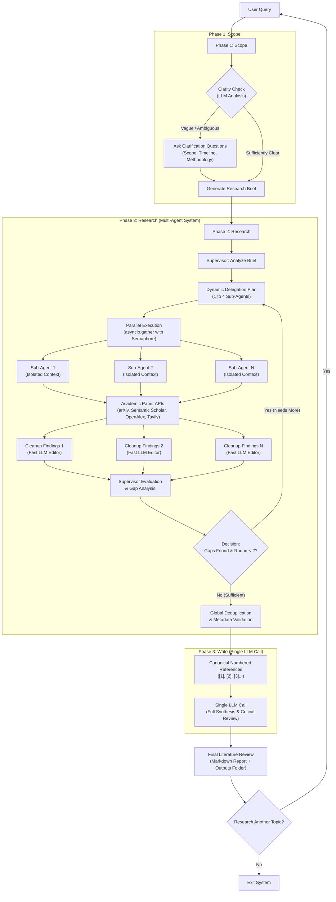

# Deep Research Agent for Academic Research Papers

An enterprise-grade, autonomous deep research system inspired by **Open Deep Research (LangChain)**, **Gemini Deep Research**, and **OpenAI Deep Research**, powered natively by **Groq API** for high-throughput, low-latency agent execution.

The agent accepts any scientific or research topic, clarifies scope when necessary, deploys parallel AI sub-agents to search real academic APIs (arXiv, Semantic Scholar, OpenAlex, Tavily), synthesizes findings with an iterative supervisor loop, and produces an extensive, publication-ready literature review with precise citations.

---

## ⚡ Primary LLM Provider: Groq API

This system defaults to **Groq** for high-speed inference:
- **Primary Model (Supervisor, Brief, Literature Review)**: `openai/gpt-oss-120b` (or `llama-3.3-70b-versatile`)
- **Fast Model (Sub-Agent Synthesis & Cleanup)**: `openai/gpt-oss-20b` (or `llama-3.1-8b-instant`)

*Alternative providers like OpenAI (`gpt-4o`) and Google Gemini (`gemini-2.0-flash`) remain supported via `.env` configuration.*

---

## 🏗️ Architecture: 3-Phase Workflow



---

## 🔒 Key Architectural Constraints Enforced

1. **Multi-Agent Exclusively in Research**: Parallel sub-agents operate only during Phase 2. Writing is performed deterministically.
2. **Single LLM Call for Final Report**: The entire literature review is synthesized in **one single LLM call** to ensure cross-theme synthesis and narrative consistency.
3. **Isolated Contexts**: Each sub-agent receives only its specific subtopic assignment, preventing context leakage.
4. **Dynamic Agent Allocation**: The supervisor determines sub-agent count dynamically based on the topic complexity.
5. **Findings Cleanup Step**: A dedicated LLM cleanup pass purges noise and extracts structured findings with citations before findings reach the supervisor.
6. **Programmatic Bound on Iterations**: Max **two additional research rounds** (3 rounds total max), enforced programmatically in `supervisor_evaluate()`.
7. **Verified Academic Sources**: Live queries to **arXiv API**, **Semantic Scholar API**, **OpenAlex API**, and **Tavily Search** (filtered to academic repositories).
8. **Anti-Hallucination & Provenance**: Claims must carry `[1], [2], [3]` citations matching the canonical reference list. Multi-pass deduplication (DOI, paper ID, fuzzy title similarity > 0.85) merges duplicate findings.

---

## 📁 Repository Structure

```
d:\Deep Research Agent\
├── src/
│   ├── __init__.py
│   ├── main.py                     # Interactive CLI entry point with continuous research loop
│   ├── config.py                   # Configuration & Groq / OpenAI / Google LLM factory
│   ├── models.py                   # Pydantic v2 structured schemas (Papers, Brief, Plan, Findings)
│   ├── state.py                    # LangGraph TypedDict state with operator.add reducers
│   ├── graph.py                    # Compiled LangGraph 3-phase state machine
│   ├── phases/
│   │   ├── __init__.py
│   │   ├── scope.py                # Phase 1: Topic clarity check & research brief generation
│   │   ├── research.py             # Phase 2: Supervisor delegation, parallel sub-agents, cleanup, evals
│   │   └── write.py                # Phase 3: Single LLM call comprehensive literature review
│   ├── tools/
│   │   ├── __init__.py
│   │   ├── arxiv_search.py         # arXiv API connector with Atom XML parser
│   │   ├── semantic_scholar.py     # Semantic Scholar API with rate-limiting & backoff
│   │   ├── openalex_search.py      # OpenAlex API with abstract_inverted_index reconstructor
│   │   └── tavily_search.py        # Tavily search restricted to academic domains
│   └── utils/
│       ├── __init__.py
│       ├── deduplication.py        # Multi-stage paper deduplication (DOI, ID, title similarity)
│       ├── paper_validator.py      # Metadata validator & citation formatter ([1], [2], [3])
│       ├── display.py              # Visual terminal display and progress reporting
│       ├── structured_helper.py    # Robust rate-limit retry & tool-calling resilience
│       └── mock_llm.py             # Mock LLM for dry-runs and automated evaluation
├── outputs/                        # Saved Markdown literature review reports
├── evaluate.py                     # Evaluation suite testing 5 distinct topic archetypes
├── requirements.txt                # Python dependencies
├── .env.example                    # Environment variable template
└── README.md                       # Complete documentation & usage guide
```

---

## 🚀 Quickstart Guide

### 1. Environment Setup
Create a `.env` file from the example:
```bash
cp .env.example .env
```
Add your Groq API key:
```env
GROQ_API_KEY=gsk_...
TAVILY_API_KEY=tvly-...
LLM_PROVIDER=groq
```

### 2. Running the Interactive UI

#### Option A: Web Browser UI (Streamlit)
Launch the web interface:
```bash
streamlit run app.py
```
This opens an interactive dashboard where you can:
- Type topics or choose from pre-set research archetypes.
- Review and respond to clarification questions interactively.
- Inspect the generated research brief before starting.
- Watch real-time multi-agent delegation, paper discovery, and supervisor evaluations.
- Read and download the final literature review directly as Markdown.

#### Option B: Terminal CLI
Start the command-line agent:
```bash
python -m src.main
```
Completed reports are saved automatically to `outputs/report_<timestamp>.md`.

### 3. Run Benchmark Evaluation
```bash
python evaluate.py
```
